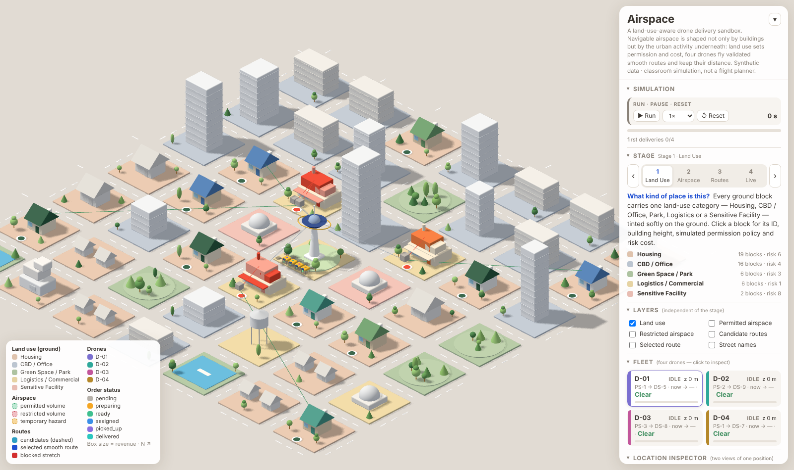
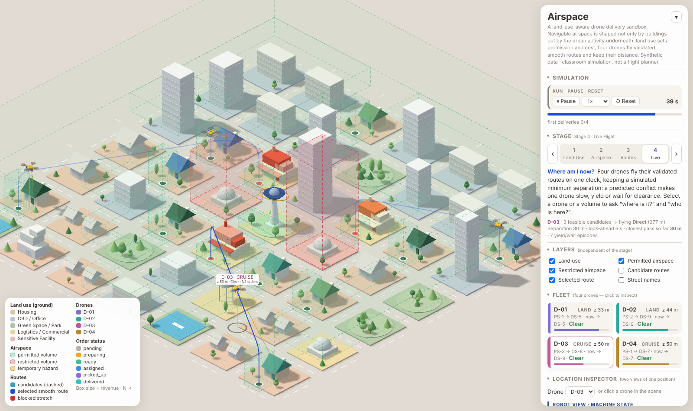

# AIRSPACE — A Land-Use-Aware Drone Delivery Sandbox

**Spatial AI Location Workshop · Revised implementation brief (V3)**  
**Scene:** Existing fictional, block-based isometric miniature city  
**Fleet:** Four independent drones  
**Design argument:** *Navigable airspace is shaped not only by buildings, but also by the urban activities underneath it.*

## 1. Goal and Scope

**Modify the existing working city simulation.** Do not rebuild it as New York or replace its charming miniature architectural style. Keep the current platform, buildings, roads, greenery, drone labels, and working interactions where possible.

The next iteration connects **ground land use → three-dimensional flight permission and cost → feasible flight corridors → smooth optimized routes → four-drone delivery behavior**. It also translates technical XYZ positions into descriptions people can understand and supports both directions of location query.

This is a conceptual classroom simulation; every constraint and weight is an adjustable model assumption, not a real flight authorization or certified safety system.

## 2. Add Land Use to Every Ground Block

Each city block must have a stable ID, its existing footprint, one primary land-use category, and a readable name. Use the geometry of the existing city rather than inventing a second disconnected grid.

| Land use | Ground appearance | Default simulated rule | Why this is interesting |
| --- | --- | --- | --- |
| **Housing** | Warm muted terracotta/beige | Conditional: low-altitude restriction; higher permitted corridor may incur privacy/noise cost | Shorter routes may pass over residents |
| **CBD / Office** | Muted blue-gray | Conditional: collision-free altitude and passage required; moderate congestion cost | Towers fragment 3D space |
| **Green Space / Park** | Sage green landscape | Conditional: modest wildlife/public-activity penalty; optional temporary bird hazard | A green *land-use* block is not automatically green *airspace* |
| **Logistics / Commercial** | Soft ochre | Preferred launch/landing and corridor connection; low modeled cost | Delivery infrastructure creates spatial anchors |
| **Sensitive Facilities** (optional) | Discrete muted coral marker | Restricted airspace volume over designated block, to a configurable altitude | Demonstrates exclusion independent of building geometry |

**Important:** These are deliberate simulation policies, **not universal legal rules**. Avoid stating that real housing, schools, parks, or CBDs are categorically allowed or forbidden. Make the rule configuration easy to adjust without rewriting geometry.

For each block, store `block_id`, `land_use`, `name`, `footprint`, `building_height` (if any), `flight_permission_policy`, `risk_cost`, and optional `restricted_altitude_interval`.

### Land Use vs. Airspace must be separate visual layers

- **Land Use Layer:** gentle, low-saturation material/tint on the *ground blocks*; show a legend for Housing, CBD, Park, Logistics, and optional Sensitive.
- **Airspace Layer:** green and red **translucent 3D volumes** with distinct top and side faces, visible vertical thickness, and dashed edges.
- **Route Layer:** candidate dashed lines and selected smooth blue 3D trajectory, floating in space.

Do not use the same bright green for a park's ground surface and a permitted airspace prism. A park is a land-use category; flight permission is a separate property.

## 3. Generate Airspace from Land Use + Geometry

For each portion of the city, determine permitted/restricted airspace by combining:

1. The underlying block's land-use policy and optional altitude-specific restrictions.
2. The full building volume (footprint extruded to roof height).
3. An adjustable simulated clearance around fixed obstacles.
4. A global simulated flight altitude envelope.
5. Any explicit restricted 3D volumes.
6. Optional temporary occupancy or moving hazard volumes.

An example conceptual formulation:

`navigable_3D_space = allowed_land_use_airspace ∩ flight_altitude_envelope − building_volumes − restricted_volumes − clearance_buffers`

**Permission is a hard constraint; risk cost is a soft preference.** A forbidden volume cannot be entered even if doing so would shorten the route. A conditional permitted volume may be traversed, but its land-use cost can discourage the optimizer.

Adjacent permitted prisms connect only if their actual XYZ interiors have a collision-free connection. A route may climb above a tower **only when the required altitude is still permitted**. Never treat a 2D footprint marked green as infinite vertical freedom.

## 4. Four-Stage Simulation

### 01 — Urban Classification

Show the miniature city with all blocks softly color-coded by land use. Clicking a block reports its category, ID, building height, simulated permission policy, and risk score. This stage answers: **What kind of place is this?**

### 02 — Airspace Generation

Construct visible mint-green *volumetric prisms* over usable airspace and transparent red 3D exclusion prisms. Geometry must reflect altitude ranges, building mass, and block rules. Optionally show amber for temporary hazard volumes. This stage answers: **Where can a drone fly?**

### 03 — Candidate Paths and Optimization

Use a 3D waypoint graph/occupancy grid to generate feasible paths through permitted space. Start and end at actual designated takeoff/landing pads; validate **complete route segments** against buildings and restricted volumes.

Generate up to three distinct feasible routes when available. Compare their costs. For a simple model:

`cost = w_length × normalized_distance + w_climb × normalized_vertical_effort + w_landuse × cumulative_landuse_penalty + w_delay × estimated_congestion_delay`

Define and display the actual objective. If a term is not implemented, omit it rather than pretending to optimize it. Treat land-use costs as accumulated over *distance traveled within a zone*, not merely a one-time fee per block.

Show candidates as thin muted dashed curves. Select one and display a **smooth continuous cobalt-blue trajectory** (e.g., safe spline/rounded transitions). **Recheck the entire smoothed curve** against 3D constraints; if smoothing cuts through buildings or forbidden volumes, use smaller smoothing or fall back to a valid path. This stage answers: **Which feasible route should it take?**

### 04 — Live Flight

Animate four distinct drones from the central hub to four distributed delivery pads. Use at least one short, one medium, and two longer trips reaching different edges of the existing city. **Inspect current destination assignment first:** the latest demonstration appears to cluster routes around the platform. Extend connected permitted volumes if necessary; do not force drones to fly extra loops just to look busy.

Update position, land-use zone, 3D airspace occupancy, flight state, and readable narration as time advances. Allow Run / Pause / Reset and drone selection.

## 5. Four-Drone Separation and Collision Avoidance

**This is a required new feature, not an optional extra.** Static building clearance and drone-to-drone avoidance are separate checks.

Each drone has current XYZ, velocity, its own chosen route, departure time, and state. At every step:

1. Check current **3D Euclidean separation** for all six pairs among four drones.
2. Predict closest approach over a configurable short look-ahead horizon along their planned trajectories, including the proposed next motion segment.
3. If separation may drop below the **simulated** minimum distance, coordinate a response: hold one drone at a safe waypoint, delay its launch, adjust speed, or replan in permitted space.
4. Give a deterministic priority rule (e.g., drone already in corridor keeps priority; waiting drone yields; break ties by ID) to avoid oscillations and deadlock.
5. Recheck building, restricted-volume, and inter-drone separation after any adjustment. No avoidance maneuver may violate another constraint.
6. When no safe response is available, pause the affected drone and display `WAITING_FOR_CLEARANCE`, never animate it through another drone.

Distinguish same XY with different Z: vertical separation counts, but only actual safe 3D separation allows simultaneous passage. Use smooth temporal motion along curves rather than merely comparing positions at coarse frames, which could miss drones crossing between frames.

Add a small inspector label: `Clear`, `Yielding`, `Waiting`, or `Rerouting`. Minimum separation and look-ahead time are classroom parameters, not real regulatory thresholds.

## 6. Two Representations of Location

Keep both displays synchronized to the **same live state**:

| Machine perspective | Human perspective |
| --- | --- |
| `D-03: (x, y, z)` | “Drone 03 is above the residential blocks east of Central Plaza.” |
| `airspace_volume=V-08; altitude=64` | “Flying through the upper corridor near Blue Tower.” |
| `land_use=Housing; risk_cost=6` | “Taking a longer route around a residential area.” **Only if the planner actually did so** |
| `status=WAITING_FOR_CLEARANCE` | “Your drone is waiting for another drone to pass.” |
| `destination=Pad C4; remaining_distance=…` | “Approaching the delivery station near Block C4.” |

Human descriptions must be generated from actual geometric relations and route/flight state. Include named block references, above/beside/north-of, height relative to roof, and passed/approaching landmarks where computed. Do not hard-code location phrases disconnected from position.

### Required bidirectional queries

- `getLocation(droneId)` → current XYZ, ground block beneath, land-use category, active 3D airspace volume, nearest landmark, status, and human-readable description.
- `getAgentsAt(volumeId)` → IDs of all drones currently **inside that specified 3D volume** (not simply sharing XY). Return `[]` when empty.

Click a drone to inspect the first query. Click a volume to inspect the second, including its permission and altitude bounds. Where multiple volumes overlap, report all actual memberships or explicitly define a priority rule.

## 7. Visual and Interface Specification

Maintain the existing elegant isometric miniature city; do not replace it with a map dashboard. Use soft daylight shadows, architectural massing, small trees, crisp modern typography, and restrained overlays.

**Main scene (~75%):** low-saturation land-use ground blocks; buildings; green/red translucent 3D volumes with dashed edges; central launch platform; four drone icons; destination pads; route curves.

**Right panel (~25%):**

1. Stage stepper: `Land Use → Airspace → Routes → Live Flight`.
2. Independent visibility toggles: Land Use, Permitted Airspace, Restricted Airspace, Candidate Routes, Selected Route.
3. Fleet list: D-01 to D-04, each selectable with status and destination.
4. Location Inspector: **Robot View / Human View** for the selected drone.
5. Spatial Inspector: selected block or airspace volume, risk/permission, height interval, and occupying drones.
6. Controls: Run, Pause, Reset; optionally risk-weight and separation-distance sliders.

**Routes:** Keep all four selectable. Dim unselected routes substantially; highlight the selected drone's smooth solid blue path. Candidate alternatives use subtler dashed cyan/violet lines. Avoid labels that cover buildings or obscure the flight space.

## 8. Verification Before Submission

- [ ] Every block has one visible land-use classification and an inspectable rule.
- [ ] Changing a land-use rule can change the permitted 3D space or route cost.
- [ ] Green/red overlays have **real 3D thickness**, not flat ground polygons.
- [ ] Four independent drones reach destinations spread across the city.
- [ ] Each candidate and smoothed chosen route remains entirely in navigable space.
- [ ] Drones do not intersect buildings, red volumes, or one another under modeled separation rules.
- [ ] A predicted drone conflict visibly results in waiting, yielding, speed change, or rerouting; if no conflict naturally occurs, include a deterministic test scenario that triggers one.
- [ ] Technical and human location descriptions update during flight.
- [ ] Agent → Location and Location → Agents return accurate current state.
- [ ] Run, Pause, Reset and overlays work without desynchronizing the simulation.

If route feasibility becomes disconnected by new restrictions, show `NO_VALID_ROUTE` and explain the blocking constraint. Do not silently teleport a drone or force a path through prohibited space.

## 9. Instructions to Coding Agent

Inspect the existing code first, including coordinate convention, renderer, route assignment, and current airspace volume representation. **Extend the existing project incrementally; preserve its visual identity and working features.** Prefer robust simplified geometry over decorative but incorrect simulation.

Implement in this priority order: **(1) land-use attributes and layers → (2) derived airspace rules → (3) longer distributed delivery assignments → (4) four-drone predictive separation → (5) route-cost integration and safe spline smoothing → (6) inspector/UI polish**. Explain where approximations were used. Do not claim actual flight safety, jurisdiction-specific permission, or validated real-world risk scores.

## 10. Workshop Deliverable and Background

This document is a project specification. For class submission, append the *actual prompts submitted to the coding agent*, a concise record of implementation outcomes/limitations, and a screenshot of the running simulation; upload the Markdown and screenshot to Steve's thread.

Background inspirations (not binding rules for the fictional city):

- CAAC, *Civil Unmanned Aircraft Operation Safety Management Rules* (CCAR-92): https://www.caac.gov.cn/PHONE/XXGK_17/XXGK/MHGZ/202401/t20240103_222566.html
- Shenzhen, *Regulations on Promoting the Low-Altitude Economy*: https://www.sz.gov.cn/zfgb/2024/gb1319/content/post_11127288.html
- *T/CSAA 21-2022: Urban Low-Altitude Drone Logistics Operating Procedures*, public standard listing: https://www.ndls.org.cn/standard/detail/f30f6403323535652fe6540dcc5b19de

These sources motivate the distinction between airspace permissions, operational corridors, and logistics infrastructure. All specific land-use restrictions and route weights in this classroom model are **hypothetical design choices**.

---

## 11 — Implementation report (appended after the build)

> The specification above is the prepared brief; this section records what was actually built, tested and simplified.

### Prompt used with the coding agent

> *"Update the current semantic simulation model based on the guideline in the markdown file [the V3 brief above]. Keep the graphic languages (stylistic features like color, rendering, design — not necessarily all the designed blocks have to be kept; constant aesthetics are more important). Iterations are acceptable based on the markdown's guideline — especially if it is necessary for updating the context of simulation while applying this location materials. Also, make all the labels invisible, and only visible when they are selected."*

### What was built (priority order of §9)

| # | Item | Implementation |
| --- | --- | --- |
| 1 | **Land-use attributes and layers** | The city is a 7 × 7 grid of 16 × 16-unit tiles (a parcel plus half the street around it); every tile is a *block* with `block_id` (A1–G7), `land_use`, `name`, `footprint`, `building_height`, `flight_permission_policy`, `risk_cost` and an optional restricted altitude interval (Block inspector shows exactly these). Five categories — Housing, CBD / Office, Green Space / Park, Logistics / Commercial, Sensitive Facility — tint the **ground slabs** softly (terracotta, blue-grey, *sage*, ochre, muted coral). Park ground is sage and deliberately not the airspace mint. The Land Use layer is an independent toggle. |
| 2 | **Derived airspace rules** | `navigable = (land-use airspace ∩ altitude envelope) − buildings − restricted volumes − clearance`. Each land use has a **floor** (Housing 45 m, others 20 m) and a **risk cost** (Housing 6, CBD 4, Park 3, Logistics 1, Sensitive 8). Permitted prisms are generated by merging tiles per altitude band (the Housing floor leaves a “hole” in the 20–45 m band only). Restricted prisms are generated over **Sensitive** blocks to a configurable altitude (Civic Hall: full height; Care Centre: 0–70 m, flyable over) plus the switchable amber hazard HZ-1. Every pad has a landing column up to the floor above it. *Permission is a hard constraint, risk is a soft cost.* Editing a floor, a risk cost or the Care Centre's restricted altitude **regenerates the prisms and re-plans every route**. |
| 3 | **Longer, distributed deliveries** | The old destinations all clustered around the platform. Four far customer pads were added near the edges (`DS-7` west, `DS-8` south-east corner, `DS-9` east, `DS-10` north) and the first four orders are scripted and pinned one per drone: **D-01 short** (hub → PS-1 → DS-5), **D-02 medium** (→ PS-2 → DS-9), **D-03 long** (→ PS-3 → DS-8, SE corner), **D-04 long** (→ PS-1 → DS-7, W edge). No loops were added; the routes are the planner's. |
| 4 | **Four-drone predictive separation** | See below. |
| 5 | **Route cost + safe smoothing** | `cost = w_length·(length ÷ straight distance) + w_climb·(climb ÷ 100 m) + w_landuse·(risk-weighted metres over land use ÷ straight distance)`. Land-use cost is accumulated **per metre flown over each tile**, measured on the actual smoothed curve. A* edges use the same per-metre multiplier, so the planner genuinely goes around expensive land (e.g. with `w_landuse = 6` the R2 → DS-9 leg detours 13 m to avoid 51 m over housing, and only then does the human view say so). The congestion-delay term is **not implemented** and is omitted from the objective. Candidates are re-tested and Bézier-smoothed; the smoothed curve is re-tested with an exact segment-in-union test (no point sampling). |
| 6 | **Inspector / UI** | Stage stepper *Land Use → Airspace → Routes → Live Flight*; independent layer toggles (Land use, Permitted, Restricted, Candidates, Selected route); fleet cards with status, destination and separation state; Robot / Human location views; Spatial inspector for a **block** or a **volume** (permission, altitude bounds, occupants); Run / Pause / Reset; sliders for the three cost weights, separation distance, look-ahead and every land-use rule. Unselected drones' routes are dimmed to about a fifth of their strength. |
| – | **Labels** | Every label (stations, orders, drones, platform, volumes, blocks, street names) is **hidden until its entity is selected**; only the selected thing is labelled. |

### Separation protocol (§5)

* **Predict:** each active drone's motion along its own smooth route is sampled over a look-ahead horizon (default 6 s); for each pair the exact closest approach over each time step is computed (so crossings between frames cannot be missed).
* **Respond:** priority is deterministic and stable — a drone standing on (or climbing out of) the pad another is heading to, then earlier departure, then lower id. A lower-priority drone **slows** (40 %), else **stops** (`WAITING_FOR_CLEARANCE`, including delayed take-off on the ground). If nothing resolves the conflict, it keeps the choice with the largest closest approach.
* **Hard guard:** no step may bring two drones in flight closer than 55 % of the configured separation while they are still approaching; the lower-priority drone stops. Nothing is ever animated through another drone.
* **Deadlocks:** when a whole group is waiting, after 5 s the lowest-priority drone **sidesteps** (a clear point in permitted space, including a different altitude band) and re-plans from there, then holds 10 s; otherwise it is promoted. Landing on an occupied pad waits in the air.
* **Inspector label:** `Clear`, `Yielding`, `Waiting`, `Rerouting` (fleet cards, Robot view, drone label). *Conflict test* (Test situations) resets with a 40 m separation so conflicts appear within seconds; they also occur naturally at the hub because the four parking slots are only 9 m apart.

### Verification (headless Chromium)

* All 24 candidate curves (4 drones × 2 legs × 3) pass the exact permitted/building/restricted test.
* 8 seeds × 500 simulated seconds at the default 30 m separation: **0** samples inside a building, a restricted prism or outside permitted airspace; the closest pass between two drones above the 20 m airspace floor never fell below the hard minimum (17 m); about 34 deliveries per run. The same holds at 15–45 m.
* Raising HZ-1 over DS-3 gives `NO_VALID_ROUTE` with the blocking volume named; clearing it resumes. Changing the Housing floor from 45 to 20 m merges the twelve prisms into one; changing `w_landuse` changes the chosen route.
* Reset is deterministic (seeded); the same seed replays identically.
* With nothing selected no label is visible; selecting a restaurant shows exactly one.

### Simplifications and limitations (please read)

* The separation protocol is a prioritised, look-ahead *heuristic*, not a proof of deadlock-freedom. At the default 30 m it is live (about 20 % of drone time spent yielding or waiting, longest single wait seen ≈ 150 s over 8 seeds); above about 35–40 m separation some seeds show long waits, so the slider stops at 40 m. The first 20 m of every take-off and landing happens inside pad columns (“ground operations”) and is not counted as flight separation; the four hub slots are only 9 m apart.
* Routing is a 2 m grid A* per altitude level (10 m steps) with line-of-sight shortening, not a full 3D optimiser; cost terms are classroom assumptions. There is no congestion-delay model, no risk model beyond the per-metre land-use cost, no battery, and the hazard is a switchable static prism rather than a moving flock.
* Land use is assigned per tile; the 12 × 12-unit parcel decides the building, the 16 × 16 tile decides the airspace. Parks are one block category, so a pond block counts as park.
* Nothing here claims real flight safety, jurisdiction-specific permission or validated risk scores.

### Screenshots

