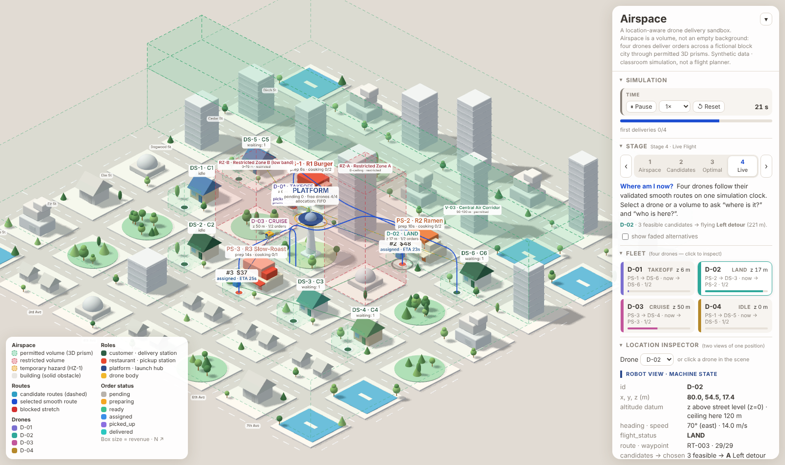

> **Superseded** by [airspace-simulation-v3.md](airspace-simulation-v3.md) (land use, derived airspace, drone separation). Kept as the V2 record.

# AIRSPACE / A Location-Aware Drone Delivery Sandbox

> **Spatial AI — Location Workshop · Revised design & implementation prompt**  
> **Environment:** existing fictional, block-based isometric city  
> **Initial fleet:** four delivery drones  
> **Concept:** *Airspace is a volume, not an empty background.*

## 01 — Overview

Extend our **existing isometric block-city simulation**, retaining its visual language, buildings, ground blocks, pickup/delivery facilities, and working interactions wherever possible. **Do not replace the scene with New York or a real map.** The city is a fictional architectural sandbox.

Four drones depart from a shared launch hub and deliver to designated destination pads. Before moving, the system determines which **three-dimensional volumes** are available for flight, generates feasible paths **inside those volumes**, then selects and flies a smooth route. The same live position is presented as (1) precise robot coordinates and (2) human-readable descriptions referencing the sandbox's blocks, landmarks, directions, and delivery progress.

### Main questions

1. **Where can a drone fly?** — 3D airspace classification.
2. **Where could it fly?** — feasible route generation.
3. **Which route should it take?** — path selection and smoothing.
4. **Where is it now, and who else is in this space?** — bidirectional location queries.

This is a **conceptual simulation, not a certified drone-navigation or real-world flight-authorization system**. All altitude limits, spacings, costs, speeds, and event parameters are simulation assumptions.

---

## 02 — Visual Direction

**Preserve the existing miniature-city aesthetic.** Aim for a polished architectural model rather than a conventional GIS dashboard or a cartoon game.

- Camera: three-quarter **isometric perspective**, with orbit and moderate zoom if already supported; retain a clear view of building heights.
- City: warm off-white / light-gray ground, desaturated blocks, simple trees, soft ambient shadows, subtle material variation.
- Buildings: legible 3D solids, including a few towers tall enough to affect flight.
- Interface: minimal modern sans-serif typography; narrow right panel; compact unobtrusive labels; generous whitespace.
- Flight-space overlay: **actual translucent three-dimensional boxes/prisms with visible height and thickness**, not flat rectangles painted on the ground.
- Maintain strong distinctions between *spatial volumes*, *candidate paths*, and the *chosen flight trajectory*.

### Visual legend

| Visual element | Rendering | Meaning |
| --- | --- | --- |
| **Permitted volume** | Soft translucent mint-green **3D prism** with thin dashed green outline on visible edges | Flight permitted *within the represented XYZ interval* |
| **Restricted volume** | Transparent blush-red **3D prism**, dashed red edges | Not available for travel |
| **Building** | Solid pale-gray 3D mass | Physical obstacle, independent of airspace permission |
| **Candidate routes** | Fine, semi-transparent dashed curves in muted cyan/violet | Multiple feasible paths under consideration |
| **Selected route** | Elegant continuous **cobalt-blue 3D curve** | Chosen route to follow |
| **Current drone** | Four distinct small drone icons/models, each with an ID | Live agents |
| **Hub / destination** | Small architectural pad markers, labeled | Fixed launch and delivery anchors |
| **Dynamic event** | Amber translucent moving volume, if implemented | Temporary modeled hazard or congestion |

The green volume should visibly **hover above or surround buildings** according to its altitude bounds, with side faces and a top face. Its outline can be dashed; it must not resemble a flat ground-plane polygon. Use conservative opacity so buildings remain readable. Likewise, a blue route is a line in 3D, not a blue filled flight region.

### Overlay sequence

At first, reveal airspace volumes alone. Then reveal candidate curves. Finally fade the alternatives and emphasize one smooth continuous blue trajectory. Avoid showing every debug line at full strength simultaneously.

---

## 03 — World and Data Model

The city is made of discrete blocks, but the drone can move continuously in XYZ space.

**Static entities**

- `building`: ID, footprint polygon or bounding rectangle, base elevation, roof height, display label.
- `airspace_volume`: ID, 3D bounds (`x_min/max`, `y_min/max`, `z_min/max`), permission (`permitted` / `restricted`), optional active time range.
- `launch_hub`: designated 3D takeoff point and optional simulated dispatch capacity.
- `delivery_pad`: designated 3D landing point, readable label, optional occupancy state.
- `landmark`: stable names such as `Central Plaza`, `Blue Tower`, `Block C3`, with coordinates/footprints.

**Dynamic entities — initialize exactly four drones**

- `drone_id`: `D-01`, `D-02`, `D-03`, `D-04`.
- `position`: `(x, y, z)`; `velocity`, `heading`, `flight_status`.
- `origin_id`, `destination_id`, `current_waypoint`, `candidate_routes`, `selected_route`.
- `current_volume_id`, `nearest_landmark`, optional `battery` and `delivery_progress`.

Use local Cartesian simulation units (preferably meters): X east, Y north, Z upward from a consistent ground reference. Declare any world-to-screen conversion or use the existing 3D camera projection. Never mix screen-pixel coordinates with physical world XYZ for collision checks.

### Essential constraint

`navigable_space = permitted_airspace_volumes − restricted_volumes − building_obstacle_volumes − required_simulated_clearance`

The result can be disconnected. A drone may **not** automatically climb above a building if the higher altitude lies outside permitted space. Adjacent permitted volumes should only be connected where there is a continuous, physically valid 3D passage.

---

## 04 — Four-Stage Simulation

### Stage 1. Classify Airspace — *Where can I fly?*

1. Construct green **3D volumes** with explicit upper and lower altitude limits.
2. Construct red restricted volumes; keep buildings as solid, non-navigable obstacles.
3. Subtract building occupancy and clearance margins from the candidate 3D flight space.
4. Visually distinguish regions even where their XY projections overlap but their Z intervals differ.
5. Check that origin and destination connect to permitted volumes through valid takeoff/landing transition paths.

**Output:** a visible three-dimensional navigable-space model. A green prism marks a permissible region, **not a promise that every point inside is free of building geometry**—the obstacle check is still required.

### Stage 2. Generate Feasible Routes — *Where could I go?*

1. Pick a drone, launch hub, and delivery pad.
2. Build a simple 3D waypoint graph or occupancy grid from navigable space; connect only collision-free edges.
3. Generate up to three distinct candidate routes (e.g., left detour, right detour, controlled climb), if such routes exist.
4. Validate entire **segments**, not only endpoints, against buildings, prohibited volumes, and clearance margins.
5. If fewer than three feasible options exist, show the actual number. Never invent extra feasible routes.

**Output:** thin dashed candidate paths, each entirely contained in valid airspace.

### Stage 3. Optimize and Smooth — *Which route is best?*

Compare feasible candidates by a simple configurable score, for example:

`route_cost = w_distance × normalized_length + w_time × normalized_duration + w_energy × normalized_climb + w_risk × normalized_risk`

For the classroom prototype, prefer the shortest feasible route if reliable time, energy, and risk models are not implemented. Show what criterion is actually used.

Select the best candidate. Turn it into a **visually smooth 3D curve** with gentle bends and altitude transitions (e.g. spline/Bezier smoothing). **Safety condition:** smoothing must not cut corners through a red zone, building, or outside a green permitted volume. Resample and collision-test the *smoothed curve*, not just its original waypoints. If the smoothed result is invalid, reduce smoothing or keep a valid piecewise path.

**Output:** a single highlighted smooth cobalt-blue route; other candidates recede to low opacity. Smooth geometry and smooth drone animation should agree.

### Stage 4. Fly and Update — *Where am I now?*

1. Dispatch up to four drones, slightly staggering takeoffs for legibility.
2. Move each drone along its validated selected 3D route using a common simulation clock.
3. Update live XYZ, named zone, landmark relationship, status, and occupancy queries every time step.
4. At an assigned delivery pad, transition to landing/complete states.
5. Optional later: a temporary restricted or moving hazard volume invalidates a route, requiring pause and replanning; never continue blindly through a newly blocked segment.

The four drones should be **independently identifiable and queryable**, not duplicates following exactly the same animation offset. They may share a hub but should have distinct destinations or departure times.

---

## 05 — Two Ways of Expressing Location

The technical and human displays describe the **same current agent state**.

| Robot / Technical Perspective | Human / Relational Perspective |
| --- | --- |
| `D-02 at (120, 85, 62)` | “Drone 02 is above Block C3.” |
| `z = 62; nearby roof z = 45` | “17 units above the roof of Blue Tower.” |
| `heading = east; route waypoint 4/9` | “Heading east toward the delivery pad.” |
| `zone = V-03; permission = permitted` | “Flying through the central air corridor.” |
| `route_status = rerouting` | “Your drone is taking a different route.” |

The numbers above are **illustrative**, not actual measured scene state.

Human-readable descriptions should be algorithmically derived from named model objects and relations:

- **Landmark-based:** above / beside / north of / between named blocks.
- **Vertical relation:** altitude relative to nearby roof, ground, or landing pad.
- **Route-based:** just passed / heading toward / approaching a named waypoint.
- **Observer-relative (optional):** left/right of a customer only if observer location **and orientation** are modeled.

Do not hard-code a fixed narration that remains unchanged while the drone moves.

---

## 06 — Bidirectional Location Queries (Required)

**Agent → Location:** `getLocation(droneId)` returns live XYZ, containing 3D airspace volume(s), nearest landmark, flight status, and human-readable description. If the drone is outside all labeled volumes, report that explicitly.

**Location → Agents:** `getAgentsAt(volumeId)` returns the IDs of all drones **currently occupying that 3D volume**. Additionally, support `getAgentsInBox(xMin, xMax, yMin, yMax, zMin, zMax)` if straightforward.

Use XYZ volume inclusion, not XY alone. With two drones directly above one another at different altitudes, the queries must distinguish them. Return an empty list if no drone occupies the selected volume.

In the scene, clicking a drone highlights it and opens its two location descriptions. Clicking a green or red volume shows volume ID, X/Y/Z extents, permission, and current drone occupancy.

---

## 07 — User Interface and Interaction

**Left / center (main canvas, ~75%):** existing isometric city, 3D colored airspace volumes, buildings, four drones, hub, pads, candidate routes, and smooth final routes. Maintain visual depth and do not clutter the city with oversized text labels.

**Right panel (~25%):**

1. **Simulation:** Play / Pause / Reset and timeline/progress.
2. **Stage:** `Airspace` → `Candidate Routes` → `Optimal Route` → `Live Flight`. Stage buttons or a stepper reveal overlays progressively; do not automatically fly at Stage 1.
3. **Fleet:** four drone entries with color/ID, active status, selectable details.
4. **Location Inspector:** compact `Robot View` and `Human View`, derived from the same selected drone.
5. **Spatial Query:** select an airspace volume and inspect permission, height interval, and drones present.

**Visual behavior:**

- Green/red prism faces remain transparent; edges may be dashed. These are **volumes, not surfaces**.
- Candidate routes are thin dashed lines; the final route is a **smooth solid blue curve** floating inside permissible space.
- Use gentle camera transitions and moving-drone animation; avoid excessive glow, particle effects, or bright saturated buildings.
- On reset, restore all four drones, selected routes, occupancy, camera defaults (if appropriate), and simulation time deterministically.

---

## 08 — Implementation Priorities and Verification

**Must work first:** reuse the existing scene; four drones; visible 3D green/red volumes; building exclusion; at least one valid path from hub to destination; smooth blue selected trajectory checked for collisions; continuous animation; both location-query directions.

**Then polish:** multiple candidates, progressive overlay reveal, readable human narration, drone selection, time controls, improved materials and camera framing.

**Optional if time remains:** volume congestion, changing restricted regions, bird-flock hazard modeled as a moving risk volume, rerouting demonstration, altitude-layer filter.

### Acceptance checklist

- [ ] The green airspace clearly has **side faces, top face, and vertical thickness**.
- [ ] The red restricted airspace is represented as an actual 3D volume.
- [ ] All four drones are visible, separately identified, and have independent live states.
- [ ] A candidate path never passes through prohibited geometry.
- [ ] The final blue route is **smooth**, and its full curve remains collision-free and within permitted space.
- [ ] A blocked route either reroutes or explicitly reports no feasible route.
- [ ] Selecting a drone answers *Where is this agent?* in technical and readable forms.
- [ ] Selecting a volume answers *Which agents are here?* using current XYZ.
- [ ] Flight-stage transitions, Play/Pause/Reset, and displays update coherently.
- [ ] One clear screenshot can show the isometric city, colored 3D volumes, final blue curve, and four drones.

---

## 09 — Coding-Agent Instructions

Implement this specification by **modifying the existing working project**, not rebuilding a disconnected new demo. First inspect the current rendering stack, coordinate conventions, scene graph, and existing agents. Reuse existing architecture. Explain briefly any limitations or simplifications.

Prioritize **actual geometric correctness** over appearance if the two conflict: a beautiful curved path that cuts through buildings or restricted volume is not an acceptable route. When full 3D route optimization is too costly, use a compact 3D waypoint graph and safe smoothing; report which optimization metric was actually implemented.

Avoid references to real Manhattan districts in the interface. Use invented block names and landmarks from the existing sandbox. The project is not based on real-world approved airspace and must not claim regulatory compliance.

## 10 — Workshop Submission

Submit (1) this Markdown specification including the **actual prompts used** with the coding agent, and (2) a screenshot of the running simulation to Steve's class thread. After implementation, append the actual prompt history, what worked, what was simplified, and the screenshot. The prepared specification alone is **not evidence that the simulation has run**.

### Background references (inspiration only)

- Civil Aviation Administration of China, *Civil Unmanned Aircraft Operation Safety Management Rules* (CCAR-92): https://www.caac.gov.cn/PHONE/XXGK_17/XXGK/MHGZ/202401/t20240103_222566.html
- Shenzhen, *Regulations on Promoting the Low-Altitude Economy*: https://www.sz.gov.cn/zfgb/2024/gb1319/content/post_11127288.html
- Chinese Society of Aeronautics and Astronautics, *T/CSAA 21-2022 Urban Low-Altitude Drone Logistics Operating Procedures* (public catalog/abstract): https://www.ndls.org.cn/standard/detail/f30f6403323535652fe6540dcc5b19de

These references inspire the distinction between permitted airspace, operational routes, and delivery infrastructure. This fictional city uses simulated rules, not real regulatory thresholds.

---

## 11 — Implementation report (appended after the build)

> The specification above is the prepared prompt; this section records what was actually built and checked.

### Prompt used with the coding agent

> *"Update this [the AIRSPACE spec above] into the current existing simulation. Keep the graphic language (stylistic features like color, rendering, design — not necessarily all the designed blocks have to be kept; constant aesthetics are more important). Iterations are acceptable based on the markdown's guideline — especially if it is necessary for updating the context of the simulation while applying these location materials."*

### What was built (modifying the existing project, not a new demo)

| Spec item | Implementation |
| --- | --- |
| Reuse the clay-style isometric city | Same scene, materials, lighting, camera and panel language. Real-district names removed (districts are now *South Block District* / *North Tower District*, the 95 m tower is *Spire Tower*, the hub plaza is *Central Plaza*). |
| 3D permitted volumes (mint, dashed edges) | `world.volumes`: decks **V-01** (South Block Deck, 20–90 m), **V-02** (North Tower Deck, 20–90 m), **V-03** (Central Air Corridor, 90–120 m, *above* V-02 in the same plan area), plus a landing column (0–20 m) at the hub and at every pad. Real `BoxGeometry` prisms with side faces, top and floor, `LineDashedMaterial` edges. |
| 3D restricted volumes (blush red) | **RZ-A** (full height), **RZ-B** (0–70 m low band that can be flown over only if the volume above permits), **HZ-1** (amber temporary hazard, switchable). |
| `navigable = permitted − restricted − buildings − clearance` | `segCheck` + `blockedGrid` in `spatial.js`: a point is navigable only if it lies inside a permitted prism (closed intervals, so touching prisms connect) and outside every building / restricted prism inflated by the clearance. The result can be disconnected: a drone cannot climb above a building if that altitude is outside every permitted volume. |
| Four-stage flow | Right-panel stepper **Airspace → Candidates → Optimal → Live**. Stages 1–3 freeze the clock; *Start flight* jumps to Stage 4. Overlays reveal progressively (volumes → dashed candidates → faded alternatives + solid cobalt route → drones). |
| Candidate routes (≤ 3, never invented) | `planMission()` finds the lowest feasible altitude, then generates alternates by blocking the middle of the latest path with a virtual disk and re-planning (left / right detour); a "climb over" candidate is added at the lowest altitude that clears the obstruction in a straight line. Candidates are de-duplicated geometrically and a kind is never repeated before another kind is shown. The count shown is the count that exists. |
| Optimize + smooth | Criterion **actually used**: `energy-weighted length = 3D distance + 1.5 × climb` (time ∝ distance; no risk model). The winner — and every candidate — is smoothed with Bézier corner arcs; each arc is re-tested with `segCheck` and its radius is halved until valid (down to a sharp corner). The whole smoothed curve is re-tested again; if anything fails, the validated polyline is kept. The drone flies exactly the curve that is drawn. |
| Fly + update | One simulation clock; four drones (`D-01…D-04`) with their own identifying colour cap, own destinations and naturally staggered take-offs (restaurant preparation times). A newly blocked stretch triggers a pause and re-plan, or an explicit `NO_VALID_ROUTE` hover — never a blind continuation. |
| Two ways of expressing location | **Robot view** (XYZ, volume ids, heading, waypoint k/n, candidates → chosen, nearest obstacle) and **Human view** (derived each tick: above a block, *n* m above a named roof, alongside a tall building, flying through a named volume, heading *compass* toward a named station, just passed a street, rerouting). |
| Bidirectional queries | `getLocation(droneId)`, `getAgentsAt("V-03")` (also `{volume}`, `{box}`, `{point, radius}`), `getAgentsInBox(xMin, xMax, yMin, yMax, zMin, zMax)`. Membership uses X, Y **and** Z of live positions. Clicking a drone opens both views; clicking a prism (or choosing it in the list) shows id, X/Y/Z extents, permission and current occupants. |
| Reset | Deterministic: seeded simulation RNG, drones, orders, routes, camera and clock restored; two replays are bit-identical at t = 20 s. |

### Context changes made to the delivery model (iterations)

* The fleet is now exactly four drones; the add / remove-drone buttons were removed.
* The first four orders are **scripted and pinned** to `D-01…D-04` (different restaurants/destinations: past the tower, around the full-height restricted prism, along an open lane, and a short hop west) so the routes previewed in Stages 2–3 are the routes flown in Stage 4. Later orders arrive on their own, as before.
* The old "nominal straight path, then reroute on conflict" behaviour was replaced by *plan and validate first*; in-flight re-planning now happens only when the world changes (hazard raised, parameters changed).

### Verification (headless Chromium, no drone left the navigable space)

* All 24 candidate curves (4 drones × 2 legs × 3) pass `segCheck` with zero violations.
* 150 simulated seconds, sampled every 0.1 s: **0** samples inside a building, an active restricted prism, or outside the permitted volumes; 12 deliveries completed.
* Stacked drones at the same plan position and different altitudes are told apart by `getAgentsAt("V-02")` vs `getAgentsAt("V-03")`; an empty volume returns `[]`; boundaries are inclusive.
* Raising HZ-1 over DS-3 mid-flight → `NO_VALID_ROUTE` hover with the named reason; clearing it → `resumed: route found again`.

### Simplifications / limitations

* Routing is a 2 m grid A* per altitude level (10 m steps) with line-of-sight shortening — not a full 3D optimizer.
* No risk, battery or time models; the "time" term is proportional to distance. Collision between drones is not modelled.
* The dynamic hazard is a switchable static prism, not a moving flock. Observer-relative left/right phrasing is not implemented.
* Parameters (clearance, ceilings, speeds) are classroom assumptions; nothing here claims regulatory compliance.

### Screenshot

