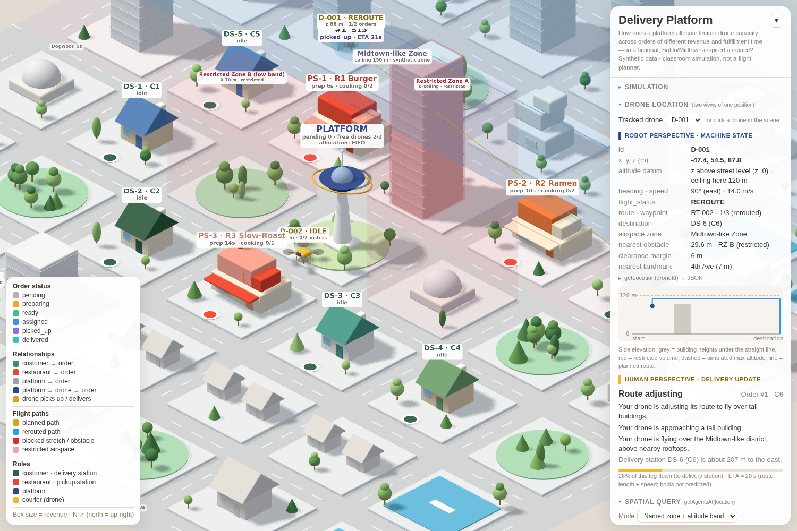

# Above the Streets — drone location layer for the delivery-platform simulation

Spatial AI · Location Workshop (Oct 8, 2026). Classroom simulation with **synthetic** geometry and **illustrative** parameters.
It is not a flight planner; no route it draws is safe, authorized or legal for real-world flight.

*D-001 (selected) is rerouting over the 95 m Midtown Tower. The Robot panel shows XYZ and spatial state, the Human panel shows
the same moment in plain language, and the query `Midtown-like Zone, z 60–100 m` returns `["D-001"]`.*

## What changed in the existing simulation

| Delivery-platform model | Drone / location layer |
|---|---|
| COURIER (cars on roads) | **Drones** `D-001`, `D-002` (up to 4) flying in 3D: `TAKEOFF → CRUISE → REROUTE / HOVER → LAND → COMPLETE` (+ `IDLE` while docked) |
| RESTAURANT | also a **pickup station** `PS-n` (landing pad at the lot front) |
| CUSTOMER | also a **delivery station** `DS-n` |
| PLATFORM, ORDER, rules 1–7, stats | unchanged; the platform's delivery-time estimate now uses planned 3D route length ÷ speed |
| background city | every building has a footprint and height and is a **3D obstacle**; two zones; restricted volumes; named streets and landmarks |

The graphic language (clay isometric city, white massing, role colours) is kept. Added visuals: translucent zone tints and restricted volumes,
rotor drones with altitude drop-lines and ground shadows, planned / rerouted / blocked path lines, a highlighted blocking obstacle, query volume and halos.

## Coordinates (documented, deterministic)

* **Local frame (robot view):** `x` east, `y` north, `z` metres above one shared ground datum (street/lot level = 0). Buildings, drones and altitude limits use the same datum.
* **Scene frame (screen):** `scene.x = x/5`, `scene.z = -y/5`, `scene.y = SLAB + z/5` (1 scene unit = 5 m), drawn with a fixed orthographic camera, so a local XYZ maps deterministically to pixels. North is up-right on screen.
* `toLocal` / `fromLocal` in `spatial.js` implement the conversion. If real geodata is added later, declare its CRS instead of mixing lon/lat with metres.

## Two representations of one location

* **Robot perspective** (panel + `getLocation` JSON): id, `x,y,z`, altitude datum and local ceiling, heading, speed, `flight_status`, route id / waypoint index, destination, airspace zone, nearest obstacle distance (+id), clearance margin, nearest landmark, plus a side-elevation chart.
* **Human perspective:** status word (Departed / On the way / Route adjusting / Arriving / Delivered / Holding position), plain sentences, bearing and distance to the destination station, leg progress and an ETA. Sentences are generated from state:

| Trigger (actual state) | Message |
|---|---|
| inside a neighbourhood polygon | “…flying over the SoHo-like / Midtown-like district” |
| trajectory crossed a street centre-line in the last 6 s | “…has just passed Dogwood St.” |
| ≥2 (or 1) buildings above the tall threshold within 40 m | “…approaching a cluster of tall buildings / a tall building” |
| `REROUTE` | “…adjusting its route” + reason (over tall buildings / around restricted airspace) |
| `HOVER` (`NO_VALID_ROUTE`) | “…holding position — no valid route is available” |
| remaining route < adjustable distance (delivery leg) | “Your delivery is approaching the receiving station.” |
| `COMPLETE` | “Your package has arrived at the delivery station.” |

“above nearby rooftops” is only used when `z` is above the roofs of buildings within 20 m, otherwise “alongside taller buildings”.
The ETA is `remaining route length ÷ speed` (vertical legs slower); it says explicitly that holds are not predicted and is replaced by “unavailable while holding”.

## Flight rules (simplified, not certified collision avoidance)

Every tick, each drone tests the next stretch of its route (sensor range 30 m) against: the map edge and zone altitude ceilings (SoHo-like 90 m, Midtown-like 150 m, capped by the simulated max altitude), building volumes + clearance margin, and restricted volumes + margin.
If blocked it replans: a grid search (2 scene-unit cells, line-of-sight smoothing) at each permitted cruise level 10 m apart, so it either **climbs over** (higher level, straight) or **detours** (lateral path), chosen by *shortest / detour first / climb first*. If no level works it **hovers** and reports `NO_VALID_ROUTE`, retrying every second (so lifting a restriction or raising the ceiling resumes the flight).

Restricted volumes: **A** (full height, over a domed hall), **B** (0–70 m band, over a park — can be flown over if the max altitude allows), **C** (temporary, closes the delivery station DS-3).

## Bidirectional queries

* `getLocation("D-001")` → `{drone_id, xyz, altitude_datum, zone, nearby_landmark, status, description, heading_deg, speed_mps, nearest_obstacle, route}`.
* `getAgentsAt({zone, z_min?, z_max?})`, `getAgentsAt({box:{x:[a,b],y:[a,b],z:[a,b]}})`, `getAgentsAt({point:[x,y,z], radius})` → `{query, agents:[ids]}`.
  Point queries use a declared radius, never coordinate equality. Both are available in the browser console and in the **Spatial query** panel, which draws the query volume and halos the matching drones. Results are recomputed from live state every 0.25 s.

## Test situations (buttons in *Flight parameters*)

| Button | Order | Observed in a headless run (default parameters) |
|---|---|---|
| Open corridor | PS-3 → DS-4 (SoHo-like) | straight cruise at 50 m, no reroute, delivered in ≈43 s |
| Tall building | PS-1 → DS-6 | Midtown Tower B-025 (95 m) on the path → `REROUTE`, detours around it |
| Tall building · climb | same | “climbing over it to 110 m” |
| Restricted zone | PS-2 → DS-3 | Zone A blocks every altitude → detour around the volume |
| Close DS-3 | PS-3 → DS-3 | destination inside Zone C → `HOVER` / `NO_VALID_ROUTE`; lifting the restriction → “route found again” → delivered |

Lowering *max altitude* (e.g. 80 m) removes the climb option; raising *clearance* or lowering the ceiling can make routes impossible — the Rules panel counts how often each rule bound an outcome (rules 8–11).

## Decisions and limitations

* Couriers became drones rather than adding a second agent type, so the delivery model (orders, priority, capacity, rules 1–7) keeps working unchanged. Capacity: 2 orders per drone, 2–4 drones.
* Buildings are axis-aligned bounding boxes of the drawn meshes (conservative for stepped/rotated shapes). Trees are not obstacles. Wind, battery, drone dynamics and other drones (no drone–drone separation) are not modelled.
* The order-status flow still follows the original model (a drone is assigned only once the order is ready).
* Zone ceilings, clearance, speeds and thresholds are classroom assumptions; they are **not** Chinese or U.S. legal limits. References inform categories only: State Council/CMC *Interim Regulations on the Flight Management of Unmanned Aircraft* (2024), CAAC CCAR-92 (2024), Shenzhen *Regulations on Promoting the Low-Altitude Economy* (2024), T/CSAA 21-2022 (abstract only). Real New York operations need separate FAA/local verification.
* Still to test: behaviour on real GPUs / touch devices, very small viewports, long (hours) runs, and non-default parameter combinations beyond the five scenarios above. Headless checks were run with software rendering only.

## Prompts

**Planning prompt (from the workshop spec):** “Organize a classroom Spatial AI workshop simulation for urban drone delivery. Represent the same drone's location both as precise XYZ/spatial constraints and as a human-readable neighborhood/landmark delivery update. Include building-height obstacles, restricted airspace, real-time bidirectional spatial queries, and a lightweight web interface. Draw inspiration from published Chinese drone-logistics regulations without treating illustrative thresholds as legal values.”

**Implementation request actually submitted to the coding agent:** the workshop document `drone_location_simulation.md` was attached with the instruction: “update this into the current existing simulation, keep the graphic language, some iterations are acceptable based if it is necessary for updating the context of simulation while applying this location materials.”
